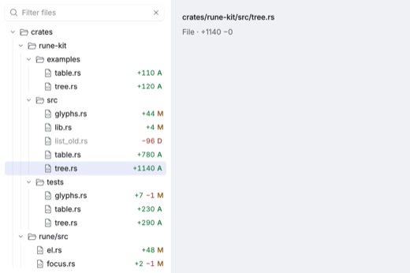
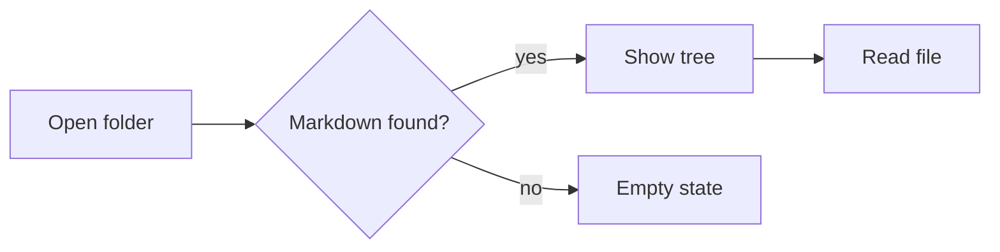
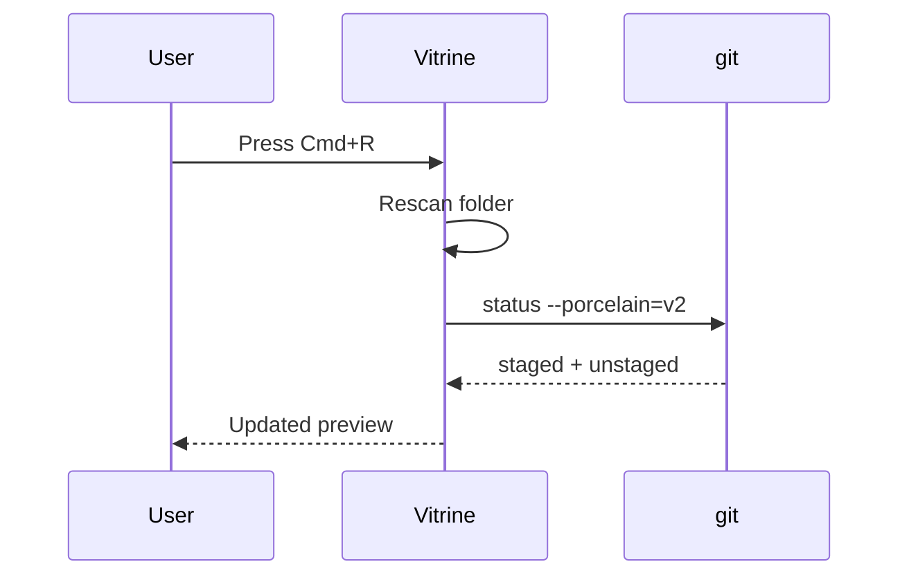
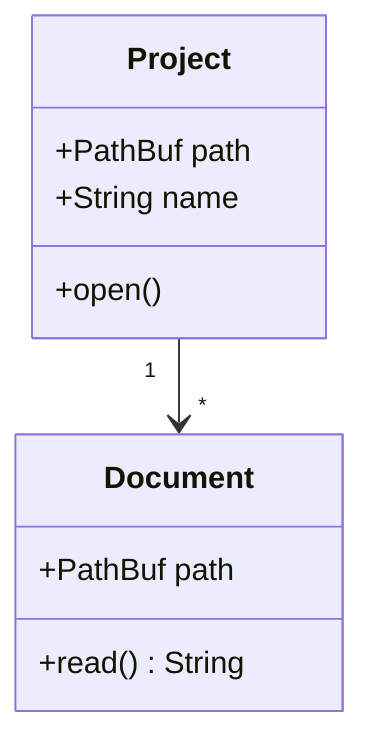
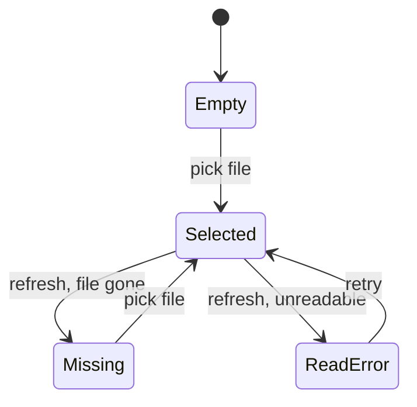
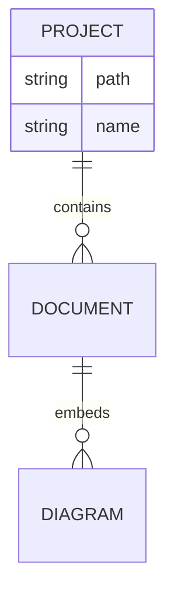

# Renderer spike

Vitrine reads **Markdown artifacts** from coding agents. This file checks prose, a table,
a normal code block, a local image and several Mermaid diagram types. See the
[spec](../../Vitrine-MVP.md) for details.

## Table

| Step | Owner  | Status      |
|------|:------:|------------:|
| Scan | Rust   | done        |
| Read | Rust   | in progress |
| Draw | Rune   | planned     |

## Code

```rust
fn main() {
    let greeting = "hello, vitrine";
    println!("{greeting}");
}
```

## Image



## Flowchart



## Sequence



## Class



## State



## Entity relationship



## Broken diagram

```mermaid
flowchart LR
    A --> 
    B[[[
```
